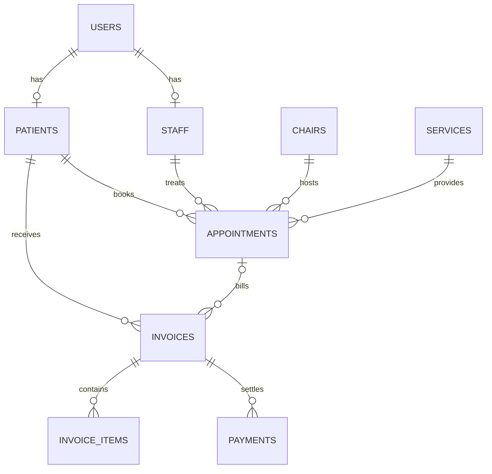

# DentaCare — Phase 1 system design and assignments

Team 5 is building a dental clinic EMR. The following assignments follow the submitted Phase 0 proposal.

| Owner | Selected features |
| --- | --- |
| Manar Yosry | Authentication, role-based access, patient profiles and portal navigation |
| Olivia Morkos | Dentist availability, chair booking, rescheduling, appointment status and history |
| Malak Saad Abdallah | Tooth records, clinical notes, treatment plans and prescriptions |
| Amany Othman | Invoices, service prices, receipt recording, balances and patient bills |
| Mai Mahmoud | Registrations, appointment outcomes, receipts, Cairo date filters, charts and CSV reports |
| Raghad AbdElhameed | Dental imaging, DICOM viewing and image adjustments, with team support for MPR and 3D |

HL7, CDSS integration, testing, integration and presentation are shared responsibilities. The course schedules CDSS and DICOM delivery for Phase 3.

## System design

The React client uses the same sign-in session across screens. Patients see their own records and bills. Clinical staff use the appointment, records and billing routes according to their roles. Administrators can access clinic-wide reports. FastAPI enforces role checks and uses SQLAlchemy sessions to read and write PostgreSQL. Alembic owns schema revisions. Billing and reporting share the same payments table.

## ER diagram for the integrated patient-to-payment workflow

The team's full design is in dentacare_er.pdf. This view traces the data used in the demonstration.

## Demonstration

From the repository root, run start-phase1.cmd with local PostgreSQL running. It prepares the dedicated dentacare_phase1_demo database, applies the migration chain, runs the starter seed and adds a linked demonstration appointment, invoice and partial payment. Existing demo invoices are retained on subsequent launches. Use the local seed admin account to open Billing and Reports, then use the seed patient account to open My Bills. Compare the payment with Reports for the payment date. The outstanding balance is shown in the invoice detail.
